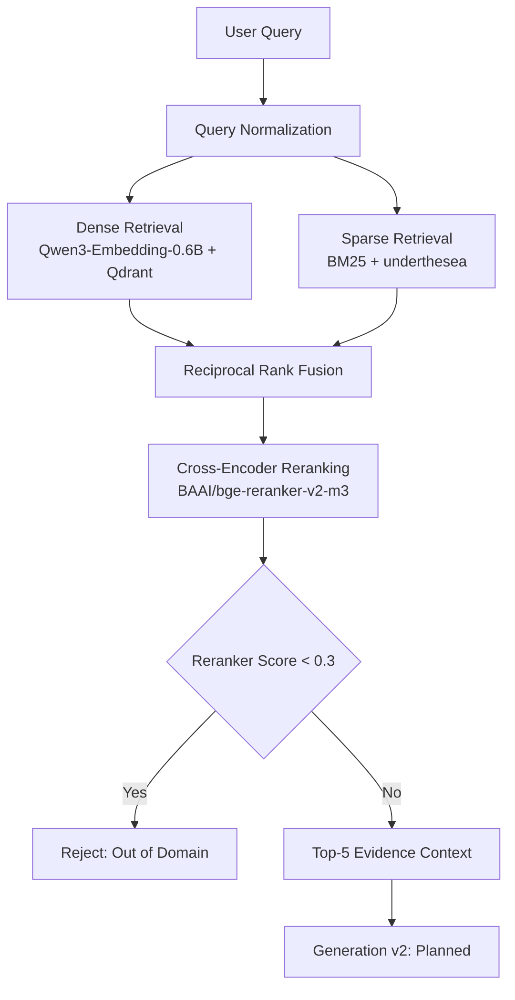

# Maternal Health RAG Assistant


> A local-first Vietnamese medical RAG system for maternal, reproductive-health, and newborn-care information, designed around evidence retrieval, traceable citations, and reproducible evaluation.

## Table of Contents

- [Problem & Motivation](#problem--motivation)
- [Key Results](#key-results)
- [System Architecture](#system-architecture)
- [Experimental Development](#experimental-development)
  - [1. Chunking & Embedding Selection](#1-chunking--embedding-selection)
  - [2. Retrieval Pipeline Selection](#2-retrieval-pipeline-selection)
- [Final System Configuration](#final-system-configuration)
- [Getting Started](#getting-started)
- [Repository Structure](#repository-structure)
- [Knowledge Sources & Reproducibility](#knowledge-sources--reproducibility)
- [Limitations](#limitations)
- [Medical Disclaimer](#medical-disclaimer)

---

## Problem & Motivation

Vietnamese maternal-health guidance is often distributed across long clinical documents containing hierarchical sections, lists, tables, numeric thresholds, and conditional recommendations. A useful assistant therefore needs to do more than retrieve semantically similar text: it must preserve source structure, recover complete evidence, and keep numbers and units grounded.

This project explores the following engineering question:

> **How can a fully local Vietnamese medical RAG pipeline achieve high evidence coverage and ranking quality while keeping answers traceable, numerically grounded, and safe for patient-facing use?**

The system is being developed through controlled experiments. **Phase 1: Retrieval** is completed and frozen. **Phase 2: Generation** is currently in design.

---

## Key Results

Metrics are reported on a held-out test set of 143 questions for the **frozen Retrieval pipeline**.

| Metric | Result |
|---|---:|
| Held-out Evidence Recall@5 | **99.30%** |
| Held-out MRR | **88.65%** |
| Held-out nDCG@5 | **90.73%** |
| Safe OOD Rejection (Margin) | **Perfect separation (margin = 0.069)** |
| Generation v2 | *Planned* |

The system combines hierarchical chunking, Qwen3 embeddings, dense + sparse retrieval, Reciprocal Rank Fusion, BGE cross-encoder reranking, and deterministic safety routing based on reranker scores.

---

## System Architecture



---

## Experimental Development

### 1. Chunking & Embedding Selection

The indexing stage compares two chunking strategies and three embedding models under the same benchmark protocol.

#### Chunking strategies

| Strategy | Design goal |
|---|---|
| Semantic chunking | Group semantically related text segments |
| **Hierarchical chunking** | Preserve headings, sections, lists, and tables |

#### Embedding models

| Model | Role | Recall@10 (DEV) |
|---|---|---:|
| `AITeamVN/Vietnamese_Embedding_v2` | Vietnamese-domain baseline | ~96.5% |
| `Qwen/Qwen3-Embedding-0.6B` | Lightweight Qwen | **96.15%** |
| `BAAI/bge-m3` | Multilingual baseline | ~98.0% |

#### Decision

**Hierarchical Chunking + Qwen3-Embedding-0.6B** was selected. Although `bge-m3` scored slightly higher on initial benchmarks, Qwen3 provided excellent MRR and nDCG while being significantly lighter. The Qwen tokenizer also segments Vietnamese more finely, ensuring that 512-token chunks do not hit the reranker's 1024 token limit.

---

### 2. Retrieval Pipeline Selection

After freezing the indexing configuration, four retrieval pipelines were compared:

1. Dense-only
2. BM25-only
3. Dense + BM25 with RRF (k=60)
4. Hybrid retrieval + cross-encoder reranking (BGE v2-m3)

#### Development comparison at K=5 (60 queries)

| Pipeline | MRR | Recall@5 | nDCG@5 |
|---|---:|---:|---:|
| Dense-only | 77.29% | 96.15% | 82.35% |
| BM25-only | 63.81% | 88.46% | 69.83% |
| Hybrid | 77.01% | 94.23% | 81.69% |
| **Hybrid + Reranker** | **81.03%** | **96.15%** | **84.65%** |

#### Decision

**Hybrid retrieval + BGE reranking** was selected because it produced the strongest ranking quality while retaining both semantic and exact lexical retrieval.

---

## Final System Configuration

The frozen Retrieval pipeline (retrieval-v1-final) operates in 5 steps:
1. **Query Encoding:** Qwen/Qwen3-Embedding-0.6B (run on CPU, `prompt_name='query'`, 1024 dims).
2. **Parallel Retrieval:** Qdrant Dense top-30 and BM25 Sparse top-30.
3. **Fusion:** Reciprocal Rank Fusion (k=60) pooling the top 30 unique candidates.
4. **Reranking:** BAAI/bge-reranker-v2-m3 (GPU, FP16, batch_size=16, max_length=1024) keeping top-5.
5. **OOD Safety Gate:** If the top-1 reranker score is `< 0.3`, the query is rejected as Out-Of-Domain. Otherwise, 5 chunks (prepended with breadcrumbs) are passed to Generation.

> **Note on Tokenizer:** The text chunks (budget=512 tokens) were segmented using the `Qwen/Qwen3-Embedding-0.6B` tokenizer (which is finer-grained for Vietnamese), rather than `bge-m3`. Therefore, this 512 budget is not directly comparable to early chunking evaluations that used `bge-m3`. This is beneficial as it prevents hitting the 1024 max_length of the reranker.

---

## Getting Started

### Prerequisites

- Python 3.10+
- Qdrant running locally
- NVIDIA GPU recommended for reranking

### 1. Clone the repository

```bash
git clone <repository-url>
cd rag-phu-san-chatbot
```

### 2. Create a Python environment

```powershell
python -m venv .venv
.\.venv\Scripts\Activate.ps1
python -m pip install --upgrade pip
pip install -r requirements.txt
```

### 3. Start Qdrant

```powershell
docker run --rm --name qdrant `
  -p 6333:6333 -p 6334:6334 `
  -v "${PWD}/data/vector_db/qdrant:/qdrant/storage" `
  qdrant/qdrant
```

### 4. Build the knowledge index

The generated vector and sparse-index artifacts are not shipped with the repository. Build them from the cleaned source documents:

```bash
python evaluation/scripts/indexing/build_vector_store.py --qdrant-mode server --host localhost --port 6333 --recreate
```

The indexing script uses the frozen configuration:

```text
Hierarchical chunking
Qwen3-Embedding-0.6B (1024 dims)
Qdrant collection: phu_san_chunks
BM25 sparse index
```

### 5. Run the application

```bash
python web_app.py
```

> **Note:** Generation v2 is still under active development. The current application will successfully retrieve evidence and test the OOD gate, returning a placeholder message indicating readiness for the generation phase.

---

## Repository Structure

```text
src/
├── indexing/
│   ├── document loading and cleaning
│   ├── chunking
│   ├── embedding
│   └── vector storage
│
├── retrieval/
│   ├── dense retrieval
│   ├── sparse retrieval
│   ├── hybrid fusion
│   └── reranking
│
└── pipeline.py
    └── end-to-end application pipeline

evaluation/
├── datasets/
│   └── benchmark questions, manifests, reviewed labels
├── schemas/
│   └── evaluation schemas
├── scripts/
│   └── indexing, retrieval evaluation
├── results/
│   └── organized benchmark outputs
└── archive/
    └── historical diagnostic artifacts
```

---

## Knowledge Sources & Reproducibility

The knowledge base is built from seven Vietnamese Ministry of Health guidance documents covering:

- prenatal care;
- reproductive health services;
- nutrition during pregnancy and lactation;
- hypertension and preeclampsia;
- gestational diabetes;
- family planning and safe abortion;
- newborn care.

To preserve experimental traceability, the repository keeps the following concepts separate:

```text
Source medical documents
        ↓
Cleaned knowledge documents
        ↓
Generated chunks / indexes
        ↓
Reviewed benchmark labels
        ↓
Model outputs
        ↓
Evaluation results
```

---

## Limitations

- Benchmark results are specific to the current document collection, reviewed evaluation set, and system configuration.
- **Known Retrieval Edge Cases:**
  - `1139_009`: Bullets in chunks that merge multiple topics might retrieve loosely related but incorrect context.
  - `776_002`: The reranker tends to incorrectly down-rank data-heavy table chunks.
  - `1359_016`: The reranker occasionally assigns high confidence to incorrect matches, which bypasses the score gate.
- The system provides evidence-based medical information only.
- It does **not** diagnose, prescribe, adjust treatment, or replace a qualified healthcare professional.

---

## Medical Disclaimer

This project is an information-retrieval and educational system based on selected Vietnamese medical guidance documents.

It is **not a doctor**, is **not a validated clinical decision-support system**, and must not be used as a substitute for professional medical evaluation, diagnosis, treatment, or emergency care.

If urgent or dangerous symptoms are present, contact emergency services or go to the nearest healthcare facility immediately.
