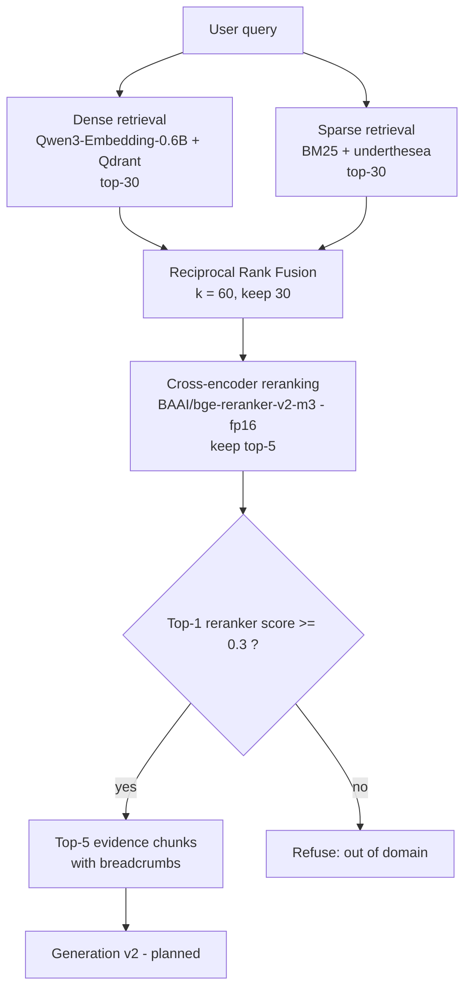

# Maternal Health RAG Assistant — Retrieval v1


> A local-first Vietnamese retrieval system for maternal, reproductive-health, and newborn-care guidance. This repository currently contains the **frozen retrieval stack** (chunking → embedding → hybrid search → cross-encoder reranking → out-of-domain gate) together with its evaluation harness. Answer generation is **planned** and not part of this release.

## Table of Contents

- [Project Status](#project-status)
- [Key Results](#key-results)
- [System Architecture](#system-architecture)
- [Evaluation Protocol](#evaluation-protocol)
- [Experimental Development](#experimental-development)
  - [1. Chunking](#1-chunking)
  - [2. Embedding Selection](#2-embedding-selection)
  - [3. Retrieval Pipeline Selection](#3-retrieval-pipeline-selection)
  - [4. Final Test Results](#4-final-test-results)
  - [5. Out-of-Domain Gate](#5-out-of-domain-gate)
  - [6. Latency](#6-latency)
- [Frozen Configuration](#frozen-configuration)
- [Limitations & Known Failure Cases](#limitations--known-failure-cases)
- [Getting Started](#getting-started)
- [Repository Structure](#repository-structure)
- [Knowledge Sources & Reproducibility](#knowledge-sources--reproducibility)
- [Roadmap](#roadmap)
- [Medical Disclaimer](#medical-disclaimer)

---

## Project Status

| Component | Status |
|---|---|
| Corpus cleaning and hierarchical chunking | Implemented, frozen |
| Dense embedding index (Qdrant) + BM25 sparse index | Implemented, frozen |
| Reciprocal Rank Fusion + cross-encoder reranking | Implemented, frozen |
| Out-of-domain score gate | Implemented, frozen |
| Retrieval evaluation harness (dev / test) | Implemented |
| Grounded answer generation, citations, safety routing | **Planned (Generation v2)** |

`RAGPipeline.answer_query()` currently returns the retrieval outcome only: a `refused` flag, the top reranker score, and the top-5 chunks. Its `answer` field is a placeholder until Generation v2 is integrated.

---

## Key Results

Final configuration (`retrieval-v1-final`): hierarchical chunking (512 tokens), Qwen3-Embedding-0.6B, BM25, RRF, `bge-reranker-v2-m3`, score gate at 0.3.

| Metric | Dev (52 in-domain + 8 OOD) | Test (143 in-domain + 22 OOD) |
|---|---:|---:|
| Evidence Recall@3 | 90.38% | 97.20% |
| Evidence Recall@5 | **96.15%** (50/52) | **99.30%** (142/143) |
| Evidence Recall@10 | 98.08% | 99.30% |
| Evidence Recall@15 | 98.08% | 100.00% |
| MRR | 81.03% | 88.65% |
| nDCG@5 | 84.65% | 90.74% |
| Top-1 correct | 37 / 52 (71.2%) | 115 / 143 (80.4%) |
| OOD AUROC (reranker top-1 score) | 1.000 | 1.000 |
| Gate @ 0.3: in-domain rejected / OOD accepted | 0 / 52 · 0 / 8 | 0 / 143 · 0 / 22 |

How to read these numbers:

- Sample sizes are small. The 95% Wilson interval for Recall@5 is roughly 87.0–98.9% on dev and 96.2–99.9% on test.
- `Complete@k` (all gold evidence of a question retrieved) equals `Recall@k` in every run reported here.
- The test split is **not fully blind**: it was run once with an earlier configuration (1058 chunks, wider candidate pool, looser evidence matching) before the configuration was revised using dev results. Those earlier results were discarded and never used for selection. The numbers above come from a single run of the frozen configuration.
- Test scores are higher than dev scores in both configurations, which indicates the test set is easier, not that the system generalises better.

---

## System Architecture



---

## Evaluation Protocol

| Item | Value |
|---|---|
| Corpus | 7 Vietnamese Ministry of Health guidance documents (see [Knowledge Sources](#knowledge-sources--reproducibility)) |
| Dev split | 60 questions: 52 in-domain, 8 out-of-domain (OOD) |
| Test split | 165 questions: 143 in-domain, 22 OOD |
| Question groups | `table`, `numeric`, `patient_style`, `hard_multi` / `multi_evidence`, per source document |
| Gold labels | Evidence spans (file, section path, text) per question; some questions require several spans |
| Evidence matching | A chunk matches a gold span using `min_coverage = 0.3` and `min_contiguous_tokens = 8`, restricted to chunks whose breadcrumb matches the gold section path (prevents identical table rows in other sections from counting as hits) |
| Metrics | Recall@k, Complete@k, MRR, nDCG@k for in-domain questions; AUROC of the top-1 score for in-domain vs OOD |
| Discipline | Dev is used for all comparisons and tuning. Test is run on the frozen configuration only |

---

## Experimental Development

The architecture was selected through staged experiments. Note that the embedding stage (Section 2) was measured on an **earlier index** (1058 chunks, 1024-token budget, looser evidence matching); Sections 3–5 use the final index (1182 chunks, 512-token budget, section-aware matching). The two stages are therefore not directly comparable.

### 1. Chunking

Two strategies were compared on structural quality (initial run, 1024-token budget, `bge-m3` tokenizer):

| | Semantic | Hierarchical |
|---|---:|---:|
| Total chunks | 1275 | 1058 |
| Chunks split beyond their section | 557 (44%) | 9 (0.9%) |
| Table chunks | 91 | 91 |
| Nested list lines preserved | 752 | 752 |
| Tokens avg / median / p95 | 219 / 186 / 447 | 257 / 219 / 556 |

Both preserved tables and nested lists with no duplicate IDs or overlength chunks. **Hierarchical** chunking was kept because it follows the Markdown section structure (a breadcrumb of H1–H6 headings is prepended to every chunk), produces fewer and more self-contained chunks, and gave equal or better retrieval for the selected embedding model.

**Final chunking** (after two dev failures traced to oversized, multi-topic chunks, the budget was lowered from 1024 to 512 tokens):

| Property | Value |
|---|---:|
| Token budget / tokenizer | 512 / `Qwen/Qwen3-Embedding-0.6B` |
| Total chunks | 1182 |
| Table chunks (of which row-split parts) | 122 (46) |
| Tokens avg / median / p95 / max | 273 / 254 / 486 / 695 |
| Nested list lines preserved | 787 |
| Chunks above budget | 1 (a 695-token table chunk, still within the reranker's 1024-token limit) |

Tables are kept atomic; oversized tables are split by rows with the caption, header, and separator repeated in each part.

> The 512-token budget is counted with the Qwen tokenizer, not `bge-m3`, so it is not comparable to the budget of the first chunking evaluation. On dev, the 512-token index did **not** change Recall@5 or MRR relative to the 1024-token index; it was kept because chunks fit the reranker window and produce shorter contexts for the future generator.

### 2. Embedding Selection

Six configurations (2 chunkers × 3 models) on dev (52 in-domain questions, 1058-chunk index):

| Chunking | Embedding | Recall@10 | MRR | nDCG@10 | OOD AUROC |
|---|---|---:|---:|---:|---:|
| Semantic | bge-m3 | 88.46% | 73.95% | 74.22% | 99.52% |
| Hierarchical | bge-m3 | 84.62% | 69.29% | 69.33% | 99.28% |
| Semantic | Qwen3-Embedding-0.6B | 96.15% | 73.09% | 75.65% | 99.28% |
| **Hierarchical** | **Qwen3-Embedding-0.6B** | **96.15%** | 73.60% | 76.08% | 98.32% |
| Semantic | Vietnamese_Embedding_v2 | 94.23% | **79.97%** | **80.94%** | 93.03% |
| Hierarchical | Vietnamese_Embedding_v2 | 94.23% | 74.49% | 76.65% | 92.55% |

**Selected: Hierarchical + Qwen3-Embedding-0.6B**, by the pre-declared policy (Complete@10, then Recall@10, nDCG@10, MRR, OOD AUROC). Honest reading of the table:

- Qwen3 and Vietnamese_Embedding_v2 differ by **one question** in Recall@10 (50 vs 49 of 52).
- Vietnamese_Embedding_v2 ranks the correct chunk higher (MRR / nDCG), whereas Qwen3 retrieves slightly more evidence and separates OOD queries by a wider margin.
- The ranking weakness of Qwen3 is addressed downstream by the cross-encoder (Section 3), which is why recall at depth was prioritised over first-hit ranking.
- Qwen3-Embedding-0.6B is small (about 1.2 GB on GPU), runs on CPU for query encoding, and leaves GPU memory for the reranker and a future local generator.

### 3. Retrieval Pipeline Selection

Dev results on the **final index and configuration** (52 in-domain questions):

| Pipeline | Recall@5 | Recall@10 | MRR | nDCG@5 |
|---|---:|---:|---:|---:|
| Dense only | 86.54% | 90.38% | 74.93% | 75.93% |
| BM25 only | 84.62% | 86.54% | 68.54% | 71.75% |
| Hybrid (dense + BM25, RRF) | 88.46% | 90.38% | 78.50% | 79.73% |
| **Hybrid + reranker** | **96.15%** | **98.08%** | **81.03%** | **84.65%** |

**Selected: Hybrid + reranker.** RRF improves on either retriever alone, and the cross-encoder adds a further +7.7 points of Recall@5 over hybrid (+9.6 over dense-only) along with the best MRR and nDCG. The reranker's score also provides a clean signal for out-of-domain rejection (Section 5).

Candidate pool: dev showed 51 of 52 questions have their evidence inside a pool of 30, identical to a pool of 50, so the pool was reduced to 30 to cut reranking time.

Subgroup behaviour of the selected pipeline:

| Group | Dev (n) | Dev R@5 | Dev MRR | Test (n) | Test R@5 | Test MRR |
|---|---:|---:|---:|---:|---:|---:|
| table | 8 | 87.5% | 48.1% | 17 | 100% | 82.8% |
| numeric | 7 | 100% | 81.4% | 18 | 100% | 94.4% |
| patient_style | 16 | 93.8% | 82.5% | 44 | 100% | 88.3% |
| hard_multi | 13 | 92.3% | 68.1% | 27 | 100% | 89.2% |

Table questions are the only group where dev and test disagree on whether reranking helps ranking (dev MRR 48.1% vs 75.5% for hybrid; test 82.8% vs 74.6%). Recall at depth is unaffected.

### 4. Final Test Results

One run of the frozen configuration on the test split (143 in-domain questions):

| Pipeline | Recall@5 | Recall@10 | MRR | nDCG@5 |
|---|---:|---:|---:|---:|
| Hybrid (RRF) | 92.31% | 96.50% | 76.65% | 79.15% |
| **Hybrid + reranker** | **99.30%** | **99.30%** | **88.65%** | **90.74%** |

- 139 of 143 questions (97.2%) have their evidence in the top 3 and 142 (99.3%) in the top 5; the single miss is in rank 14 (see [Known Failure Cases](#limitations--known-failure-cases)).
- Per document, every source reaches 100% Recall@5 except `qd_1359` (95.2%, one question).

### 5. Out-of-Domain Gate

The gate rejects a query when the **top-1 reranker score is below 0.3** (reranker scores are sigmoid outputs in [0, 1]).

| | Dev | Test |
|---|---:|---:|
| Mean top-1 score, in-domain | 0.936 | 0.948 |
| Mean top-1 score, OOD | 0.047 | 0.029 |
| Lowest in-domain score | 0.429 | **0.308** (`EVAL_QD_4128_018`) |
| 2nd lowest in-domain score | 0.567 | 0.327 (`EVAL_QD_1359_028`) |
| Highest OOD score | 0.215 | 0.239 (`OOD_019`) |
| AUROC | 1.000 | 1.000 |

The threshold was chosen on dev and not adjusted on test. On both splits it produces no false rejections and no false accepts, but the margin is thin on the in-domain side: the lowest in-domain test score is only 0.008 above the threshold. Real user queries that are vague or partly out of scope will fall in this region, so the gate should be treated as a coarse filter. Only 30 OOD questions (8 dev, 22 test) were evaluated and none were adversarial. The gate also cannot catch confidently wrong retrievals (see below). Reciprocal-rank-fusion scores are not usable for rejection (AUROC 0.95 dev / 0.92 test).

### 6. Latency

Measured on the development machine (RTX 5060 Laptop GPU, 8 GB; query embedding on CPU; reranker fp16 on GPU). Model loading is excluded.

| Measurement | Result | Of which |
|---|---:|---|
| `RAGPipeline.answer_query`, dev (60 queries, sequential, after warm-up) | **median 0.985 s, p95 1.207 s** (min 0.814 s, max 1.366 s) | hybrid retrieval incl. CPU query encoding 0.548 s mean + reranking 0.451 s mean |
| Evaluation harness, test (165 queries, `hybrid_rerank` run) | 562 ms mean | reranker inference 429 ms mean |
| Evaluation harness, dev (60 queries, `--pipeline all` run) | 519 ms mean | reranker inference 445 ms mean |

The `answer_query` row is the figure to use for planning; it is taken from `evaluation/reports/latency_production_log.txt`. Evaluation-harness timings depend on the run mode (in a `--pipeline all` run, candidate generation reuses work done by the dense and sparse passes) and exclude per-request overhead, so they are lower. Latency varies between runs with machine load: an earlier measurement of the same path gave a median of about 1.6 s. Reranker load time is 4.6–7.0 s once at start-up (`warm_up()` also runs a dummy rerank). Generation time will be added on top in Generation v2.

---

## Frozen Configuration

Tag: `retrieval-v1-final`. Machine-readable manifest with hashes, library versions, and model revisions: `data/vector_db/index_manifest.json`; dependency lock: `requirements.frozen.txt`.

| Component | Setting |
|---|---|
| Corpus | 7 files in `data/cleaned/` (hashes in manifest) |
| Chunker | Hierarchical Markdown (H1–H6), 512-token budget (Qwen tokenizer), 100-token overlap inside split sections, tables atomic or row-split with repeated header, breadcrumb prepended; 1182 chunks |
| Dense embedding | `Qwen/Qwen3-Embedding-0.6B`, 1024 dimensions, cosine; queries encoded with `prompt_name="query"` on CPU |
| Vector store | Qdrant, collection `chunks` |
| Sparse | BM25 with `underthesea` word segmentation (`data/vector_db/bm25_index.pkl`) |
| Candidate generation | Dense top-30 and BM25 top-30 |
| Fusion | Reciprocal Rank Fusion, `k = 60`, pool of 30 |
| Reranker | `BAAI/bge-reranker-v2-m3`, fp16, `max_length = 1024`, batch size 16, keep top-5 |
| OOD gate | Reject if top-1 reranker score `< 0.3` |

---

## Limitations & Known Failure Cases

- **Small evaluation sets** (52 dev / 143 test in-domain questions): differences of a few points are within noise.
- **Test is not fully blind** (see [Key Results](#key-results)). Evidence matching is heuristic (token coverage and overlap thresholds), and some gold spans can match several chunks.
- **Embedding-stage results** (Section 2) were measured on the earlier 1058-chunk index with looser matching. On the final index, dense-only Recall@10 on dev is 90.38%, so the embedding table should not be read as final-pipeline performance.
- **Known retrieval failure cases:**
  - `EVAL_QD_1139_009` (dev): never retrieved by any pipeline. The gold bullet sits inside a chunk that merges many counselling topics, so dense and BM25 signals are diluted; the reranker's top-1 is a different chunk with score 0.87.
  - `EVAL_QD_776_002` (dev): a small, correct table chunk is ranked first by dense, BM25, and hybrid search, but the reranker moves it to rank 10 (top-1 score 0.988 for another chunk). Rerankers handle numeric Markdown tables poorly.
  - `EVAL_QD_1359_016` (test): the gold chunk is at rank 14 while the top-1 chunk scores 0.993. The question ("role of the counsellor...") matches many similar passages. Confident but wrong retrievals pass the gate.
- **One chunk exceeds the 512-token budget** (695 tokens, a table). It is still within the reranker window.
- **Concurrency:** `RAGPipeline` serialises requests with a lock; it is designed for a single local user.
- **Scope:** the system retrieves evidence from seven guideline documents. It does not generate answers, verify citations, or route emergencies yet.

---

## Getting Started

### Prerequisites

- Python 3.10+
- Docker (for Qdrant)
- NVIDIA GPU recommended for reranking (CPU fallback is supported but slower)

### 1. Environment

```powershell
python -m venv .venv
.\.venv\Scripts\Activate.ps1
python -m pip install --upgrade pip
pip install -r requirements.frozen.txt
```

On macOS / Linux use `python3 -m venv .venv` and `source .venv/bin/activate`.

### 2. Start Qdrant

```powershell
docker run -d --name qdrant `
  -p 6333:6333 -p 6334:6334 `
  -v "${PWD}/data/vector_db/qdrant:/qdrant/storage" `
  qdrant/qdrant
```

On macOS / Linux replace the backticks with backslashes and `${PWD}` with `$(pwd)`.

### 3. Build the indexes

Generated artifacts are not shipped. Build them from `data/cleaned/`:

```powershell
python evaluation\scripts\indexing\run_chunking_eval.py --model Qwen/Qwen3-Embedding-0.6B --max-tokens 512
python evaluation\scripts\indexing\build_vector_store.py --qdrant-mode server --host localhost --port 6333 --collection chunks --recreate
```

This produces the Qdrant collection `chunks` (1182 points, 1024 dimensions, cosine) and `data/vector_db/bm25_index.pkl`.

### 4. Evaluate retrieval

```powershell
# Development split (used for all comparisons and tuning)
python evaluation\scripts\retrieval\run_retrieval_eval.py --split dev --pipeline all

# Test split: run once, on the frozen configuration only
python evaluation\scripts\retrieval\run_retrieval_eval.py --split test --pipeline hybrid_rerank
```

### 5. Use the pipeline

With `src/` on `PYTHONPATH`:

```python
from pathlib import Path
from pipeline import RAGPipeline

pipeline = RAGPipeline(Path("."))
pipeline.warm_up()
response = pipeline.answer_query("Bà mẹ cho con bú cần bao nhiêu vitamin D mỗi ngày?")
print(response.refused, response.top_score, response.chunks)
```

---

## Repository Structure

```text
src/
├── indexing/          chunking, embedding, vector storage
├── retrieval/         dense, sparse, fusion (RRF), reranker, config
└── pipeline.py        retrieval + reranking + OOD gate (generation planned)

evaluation/
├── datasets/          benchmark questions with gold evidence
├── schemas/           evaluation schemas
├── scripts/           indexing and retrieval evaluation scripts
└── results/           generated outputs (git-ignored)

data/
├── cleaned/           source guideline documents (Markdown)
└── vector_db/         generated indexes and index_manifest.json

logs/                  runtime diagnostics (git-ignored)
```

---

## Knowledge Sources & Reproducibility

The knowledge base is built from seven Vietnamese Ministry of Health documents:

| File | Topic |
|---|---|
| `qd_1139_2026` | Pre-pregnancy and prenatal care |
| `qd_1154_2024` | Hypertension, pre-eclampsia, eclampsia |
| `qd_1359_2026` | Safe abortion and family planning |
| `qd_1470_2024` | Gestational diabetes |
| `qd_2323_2025` | Newborn care and treatment |
| `qd_4128_2016` | Reproductive-health services |
| `qd_776_2017` | Nutrition in pregnancy and lactation |

Reproducibility is supported by: the git tag `retrieval-v1-final`; an index manifest with SHA-256 hashes of the chunk file, the BM25 index, and the evaluation dataset; Hugging Face revisions of the embedding and reranker models; and the frozen dependency list. Raw benchmark outputs are git-ignored; summary reports used in this document should be committed under `evaluation/reports/`.

---

## Roadmap

**Generation v2 (planned):**

1. An output contract that answers only from the top-5 chunks and cites `chunk_id`s, with a refusal path.
2. Model selection on dev by measured faithfulness, numeric fidelity, citation accuracy, and refusal behaviour, starting from the known failure cases above.
3. A grey zone for scores between 0.3 and 0.5 (answer with an explicit caution rather than a hard refusal).
4. Query-side steps (normalisation, safety routing) added only if they measurably improve dev results.

---

## Medical Disclaimer

This project is an information-retrieval and educational system based on selected Vietnamese medical guidance documents.

It is **not a doctor**, is **not a validated clinical decision-support system**, and must not be used as a substitute for professional medical evaluation, diagnosis, treatment, or emergency care.

If urgent or dangerous symptoms are present, contact emergency services or go to the nearest healthcare facility immediately.