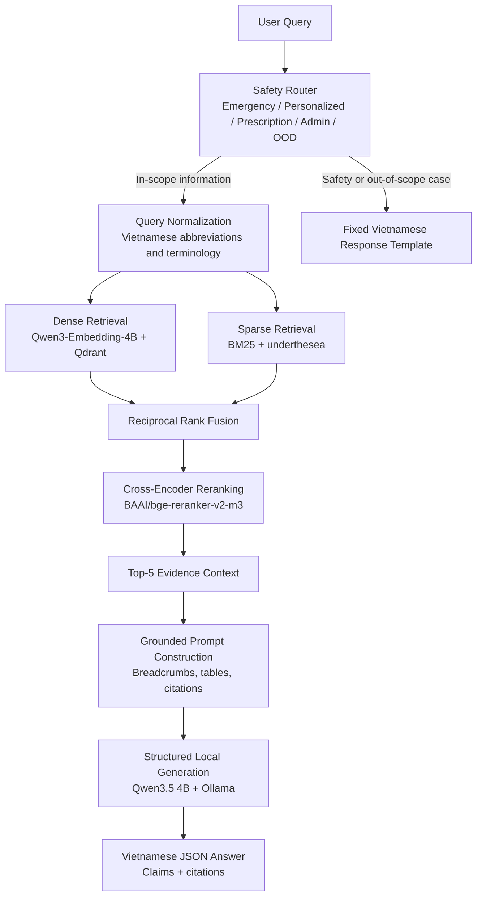

# Maternal Health RAG Assistant


> A local-first Vietnamese medical RAG system for maternal, reproductive-health, and newborn-care information, designed around evidence retrieval, traceable citations, conservative safety routing, and reproducible evaluation.

## Table of Contents

- [Problem & Motivation](#problem--motivation)
- [Key Results](#key-results)
- [System Architecture](#system-architecture)
- [Engineering Goals](#engineering-goals)
- [Experimental Development](#experimental-development)
  - [1. Chunking & Embedding Selection](#1-chunking--embedding-selection)
  - [2. Retrieval Pipeline Selection](#2-retrieval-pipeline-selection)
  - [3. Medical Safety Evaluation](#3-medical-safety-evaluation)
  - [4. Grounded Answer Generation](#4-grounded-answer-generation)
- [Final System Configuration](#final-system-configuration)
- [Performance](#performance)
- [Getting Started](#getting-started)
- [Repository Structure](#repository-structure)
- [Knowledge Sources & Reproducibility](#knowledge-sources--reproducibility)
- [Limitations](#limitations)
- [Medical Disclaimer](#medical-disclaimer)

---

## Problem & Motivation

Vietnamese maternal-health guidance is often distributed across long clinical documents containing hierarchical sections, lists, tables, numeric thresholds, and conditional recommendations. A useful assistant therefore needs to do more than retrieve semantically similar text: it must preserve source structure, recover complete evidence, keep numbers and units grounded, expose traceable citations, and handle safety-sensitive questions conservatively.

This project explores the following engineering question:

> **How can a fully local Vietnamese medical RAG pipeline achieve high evidence coverage and ranking quality while keeping answers traceable, numerically grounded, and safe for patient-facing use?**

Instead of choosing a single RAG stack manually, the system is developed through controlled experiments across chunking, embeddings, retrieval, reranking, safety routing, and structured generation.

---

## Key Results

| Area | Result |
|---|---:|
| Held-out Evidence Recall@5 | **95.17%** |
| Held-out Evidence Complete@5 | **93.10%** |
| Held-out MRR | **78.08%** |
| Held-out nDCG@5 | **80.19%** |
| Held-out OOD AUROC | **100.00%** |
| Emergency red-flag recall | **16/16 = 100%** |
| Rule-based safety regression | **305/305 = 100%** |
| JSON parse without retry | **30/30 = 100%** |
| Valid citation references | **30/30 = 100%** |
| Clear numeric/unit errors in manual spot-check | **0/30** |
| Warm end-to-end latency | **~21 s/query** |

The final system combines hierarchical chunking, Qwen3 embeddings, dense + sparse retrieval, Reciprocal Rank Fusion, BGE cross-encoder reranking, deterministic safety routing, claim-level citations, and local structured generation.

---

## System Architecture




---

## Engineering Goals

The project is intentionally designed as an evaluated RAG system rather than a simple `PDF → embedding → vector DB → LLM` demo.

| Goal | Design choice |
|---|---|
| Preserve clinical document structure | Hierarchical Markdown chunking |
| Retrieve both semantic and exact-term matches | Dense retrieval + BM25 |
| Improve candidate ordering | Cross-encoder reranking |
| Preserve Vietnamese lexical matching | `underthesea` word segmentation |
| Keep evidence traceable | Source metadata + breadcrumbs + `chunk_id` |
| Handle tables correctly | Table-preserving context construction |
| Avoid unsupported low-evidence answers | Deterministic score gate |
| Handle emergency and unsafe requests conservatively | Rule-based safety routing before retrieval |
| Keep numbers and units grounded | Structured generation contract + validation |
| Make local execution possible | Qdrant + Ollama + local models |
| Make design choices defensible | Controlled benchmarks and held-out evaluation |

---

## Experimental Development

The final architecture was selected through staged experiments instead of being chosen in advance.

### 1. Chunking & Embedding Selection

The indexing stage compares two chunking strategies and three embedding models under the same benchmark protocol.

#### Chunking strategies

| Strategy | Design goal |
|---|---|
| Semantic chunking | Group semantically related text segments |
| Hierarchical chunking | Preserve headings, sections, lists, and tables |

#### Embedding models

| Model | Role |
|---|---|
| `AITeamVN/Vietnamese_Embedding_v2` | Vietnamese-domain baseline |
| `Qwen/Qwen3-Embedding-4B` | Larger multilingual embedding model |
| `BAAI/bge-m3` | Multilingual baseline |

#### Held-out indexing benchmark

| Chunking | Embedding | Recall@10 | Complete@10 | MRR | nDCG@10 | OOD AUROC |
|---|---|---:|---:|---:|---:|---:|
| Semantic | Vietnamese_Embedding_v2 | 96.79% | 94.29% | 70.91% | 72.97% | 96.57% |
| **Hierarchical** | **Qwen3-Embedding-4B** | **97.86%** | **97.86%** | **84.34%** | **85.70%** | **100.00%** |
| Hierarchical | bge-m3 | 99.29% | 98.57% | 76.50% | 79.62% | 99.96% |

#### Decision

**Hierarchical Chunking + Qwen3-Embedding-4B** was selected.

Although `bge-m3` achieved slightly higher Recall@10, the Qwen3 configuration produced substantially stronger ranking quality in MRR and nDCG while also reaching perfect OOD separation on this benchmark. Hierarchical chunking was retained because the downstream generator depends on section context, tables, and traceable document structure.

---

### 2. Retrieval Pipeline Selection

After freezing the indexing configuration, four retrieval pipelines were compared:

1. Dense-only
2. BM25-only
3. Dense + BM25 with RRF
4. Hybrid retrieval + cross-encoder reranking

#### Development comparison at K=5

| Pipeline | Evidence Recall@5 | Evidence Complete@5 | MRR | nDCG@5 |
|---|---:|---:|---:|---:|
| Dense-only | 98.00% | 96.00% | 89.40% | 88.51% |
| BM25-only | 75.00% | 70.00% | 62.81% | 60.36% |
| Hybrid | 97.00% | 96.00% | 86.02% | 82.93% |
| **Hybrid + Reranker** | **100.00%** | **100.00%** | **91.83%** | **90.41%** |

#### Decision

**Hybrid retrieval + BGE reranking** was selected because it produced the strongest development result at K=5 while retaining both semantic and exact lexical retrieval.

#### Held-out retrieval result

| Metric | Result |
|---|---:|
| Evidence Recall@5 | **95.17%** |
| Evidence Complete@5 | **93.10%** |
| MRR | **78.08%** |
| nDCG@5 | **80.19%** |
| OOD AUROC | **100.00%** |

This held-out benchmark is kept separate from the development comparison used to choose the retrieval design.

---

### 3. Medical Safety Evaluation

Safety-sensitive routing is deterministic wherever possible and happens before normal retrieval and generation.

The router handles:

- emergency red-flag queries;
- personalized diagnosis requests;
- prescription-change requests;
- administrative requests;
- out-of-domain questions;
- normal in-scope medical-information queries.

Low-scoring evidence is also blocked by a deterministic evidence gate, and the LLM fallback classifier is treated as suggestion-only rather than being trusted to make autonomous emergency decisions.

#### Reviewed safety benchmark

| Metric | Result |
|---|---:|
| Rule-based regression | **305/305 = 100%** |
| Emergency red-flag recall | **16/16 = 100%** |

The goal is not to turn the system into a diagnostic tool. Safety routing exists to make unsupported or high-risk interactions terminate conservatively before normal answer generation.

---

### 4. Grounded Answer Generation

The final generator uses `qwen3.5:4b` through Ollama and returns structured JSON.

```text
answer
citations[]
insufficient_evidence
confidence
```

Each citation contains:

```text
claim
reference_number
chunk_id
```

The generation layer is designed around four constraints:

- answer in Vietnamese;
- preserve numbers and units exactly from the evidence;
- retain table row/column/condition context;
- attach claims to retrieved evidence through valid citation references.

#### Development generation checks

| Metric | Result |
|---|---:|
| JSON parse without retry | **30/30 = 100%** |
| Valid citation references | **30/30 = 100%** |
| Clear numeric/unit errors in manual spot-check | **0/30** |
| OOD abstention case | **Correct** |

These checks are development-level validation rather than a claim of clinical correctness.

---

## Final System Configuration

| Component | Final choice |
|---|---|
| Document processing | Cleaned Vietnamese Ministry of Health guidance |
| Chunking | Hierarchical Markdown chunking |
| Dense embedding | `Qwen/Qwen3-Embedding-4B` |
| Vector database | Qdrant |
| Sparse retrieval | BM25 + `underthesea` |
| Dense candidate pool | Top-15 |
| Sparse candidate pool | Top-15 |
| Fusion | Reciprocal Rank Fusion |
| RRF constant | `k = 60` |
| Hybrid candidate pool | Top-15 |
| Reranker | `BAAI/bge-reranker-v2-m3` |
| Final evidence context | Top-5 |
| Safety routing | Deterministic rule-based classifier |
| Prompt construction | Breadcrumb-aware, table-preserving context builder |
| Generation | `qwen3.5:4b` via Ollama |
| Structured output | JSON validated with Pydantic |
| Reasoning mode | `think=false` |
| Evidence score gate | `0.10` |

---

## Performance

Measured on an NVIDIA RTX 5060 Laptop GPU with 8 GB VRAM:

| Stage | Typical latency |
|---|---:|
| Retrieval + reranking | ~1.68 s/query |
| Answer generation | ~19.40 s/query |
| **Warm end-to-end** | **~21 s/query** |

The runtime uses a model-lifecycle strategy to fit the available GPU memory:

```text
Embedding model
   ↓ unload
Reranker
   ↓ unload
Generation model
```

This keeps peak GPU memory within the laptop hardware budget while preserving a fully local pipeline.

> Latency will vary across hardware. The values above are measurements from the development machine, not universal runtime guarantees.

---

## Getting Started

### Prerequisites

- Python 3.10+
- Ollama installed and running
- Qdrant running locally
- NVIDIA GPU recommended for reranking and local-generation latency similar to the reported measurements

### 1. Clone the repository

```bash
git clone <repository-url>
cd rag-phu-san-chatbot
```

### 2. Create a Python environment

#### Windows PowerShell

```powershell
python -m venv .venv
.\.venv\Scripts\Activate.ps1
python -m pip install --upgrade pip
pip install -r requirements.txt
```

#### macOS / Linux

```bash
python3 -m venv .venv
source .venv/bin/activate
python -m pip install --upgrade pip
pip install -r requirements.txt
```

### 3. Start Qdrant

#### macOS / Linux

```bash
docker run --rm --name qdrant \
  -p 6333:6333 -p 6334:6334 \
  -v "$(pwd)/data/vector_db/qdrant:/qdrant/storage" \
  qdrant/qdrant
```

#### Windows PowerShell

```powershell
docker run --rm --name qdrant `
  -p 6333:6333 -p 6334:6334 `
  -v "${PWD}/data/vector_db/qdrant:/qdrant/storage" `
  qdrant/qdrant
```

### 4. Build the knowledge index

The generated vector and sparse-index artifacts are not shipped with the repository. Build them from the cleaned source documents:

```bash
python evaluation/scripts/indexing/build_vector_store.py --qdrant-mode server --host localhost --port 6333 --recreate
```

The indexing script uses the frozen configuration:

```text
Hierarchical chunking
Qwen3-Embedding-4B
Qdrant collection: phu_san_chunks
BM25 sparse index
```

### 5. Pull the local generation model

```bash
ollama pull qwen3.5:4b
```

### 6. Run the application

```bash
python web_app.py
```

Open:

```text
http://localhost:8000
```

> Qdrant must be running, source documents must be available under `data/cleaned/`, and the knowledge index must be built before starting the application.

---

## Repository Structure

```text
src/
├── indexing/
│   ├── document loading and cleaning
│   ├── chunking
│   ├── embedding
│   └── vector storage
│
├── query/
│   ├── safety rules
│   ├── classification
│   ├── templates
│   └── query normalization / rewriting
│
├── retrieval/
│   ├── dense retrieval
│   ├── sparse retrieval
│   ├── hybrid fusion
│   └── reranking
│
├── generation/
│   ├── context construction
│   ├── prompts
│   ├── schemas
│   └── local generation
│
└── pipeline.py
    └── end-to-end application pipeline

evaluation/
├── datasets/
│   └── benchmark questions, manifests, reviewed labels
├── schemas/
│   └── evaluation schemas
├── scripts/
│   └── indexing, retrieval, query, and generation evaluation
├── results/
│   └── organized benchmark outputs
└── archive/
    └── historical diagnostic artifacts
```

---

## Knowledge Sources & Reproducibility

The knowledge base is built from seven Vietnamese Ministry of Health guidance documents covering:

- prenatal care;
- reproductive health services;
- nutrition during pregnancy and lactation;
- hypertension and preeclampsia;
- gestational diabetes;
- family planning and safe abortion;
- newborn care.

To preserve experimental traceability, the repository keeps the following concepts separate:

```text
Source medical documents
        ↓
Cleaned knowledge documents
        ↓
Generated chunks / indexes
        ↓
Reviewed benchmark labels
        ↓
Model outputs
        ↓
Evaluation results
```

Benchmark datasets, manifests, evaluation scripts, and reported metrics are organized separately from generated outputs so that system development decisions can be reproduced and audited.

---

## Limitations

- Warm end-to-end latency is approximately **21 seconds/query** on the current RTX 5060 Laptop GPU.
- Long, table-heavy answers may still require a JSON-generation retry.
- Citation validation confirms reference structure and traceability, not clinical correctness.
- Numeric/unit checks are conservative safeguards and do not replace expert medical review.
- Benchmark results are specific to the current document collection, reviewed evaluation set, and system configuration.
- The system provides evidence-based medical information only.
- It does **not** diagnose, prescribe, adjust treatment, or replace a qualified healthcare professional.

---

## Medical Disclaimer

This project is an information-retrieval and educational system based on selected Vietnamese medical guidance documents.

It is **not a doctor**, is **not a validated clinical decision-support system**, and must not be used as a substitute for professional medical evaluation, diagnosis, treatment, or emergency care.

If urgent or dangerous symptoms are present, contact emergency services or go to the nearest healthcare facility immediately.
