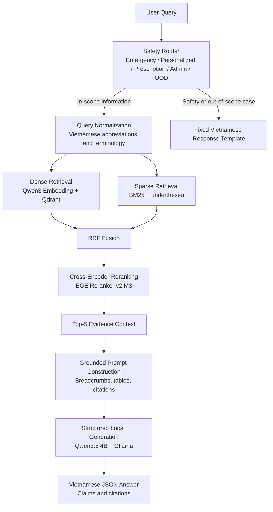

# Maternal Health RAG Assistant


> A Vietnamese medical RAG system for maternal and reproductive health, combining hybrid retrieval, cross-encoder reranking, deterministic safety routing, grounded citations, and structured local LLM generation.

## Table of Contents

- [Highlights](#highlights)
- [Architecture](#architecture)
- [What Makes This More Than a Basic RAG Demo](#what-makes-this-more-than-a-basic-rag-demo)
- [Technical Design](#technical-design)
- [Indexing Experiments](#indexing-experiments)
- [Retrieval Experiments](#retrieval-experiments)
- [Medical Safety Design](#medical-safety-design)
- [Answer Generation](#answer-generation)
- [Benchmark Results](#benchmark-results)
- [Performance](#performance)
- [Getting Started](#getting-started)
- [Repository Structure](#repository-structure)
- [Knowledge Sources and Reproducibility](#knowledge-sources-and-reproducibility)
- [Limitations](#limitations)
- [Medical Disclaimer](#medical-disclaimer)
- [License](#license)

## Highlights

- **95.17% Evidence Recall@5** on the held-out retrieval benchmark
- **93.10% Evidence Complete@5**
- **100% emergency red-flag recall** on 305 human-reviewed queries
- Fully local runtime with Qwen, Qdrant, BM25, and Ollama, with GPU-accelerated reranking
- Claim-level citations mapped back to source chunks
- Deterministic score-gated abstention for low-evidence queries
- Vietnamese-language, table-aware, evidence-grounded answer generation

## Architecture



## What Makes This More Than a Basic RAG Demo

This project goes beyond a simple "PDF → embeddings → vector database → LLM" workflow. It includes:

- controlled dense, sparse, hybrid, and reranked retrieval experiments;
- hierarchical chunking that preserves document structure and tables;
- Vietnamese word segmentation for lexical retrieval;
- deterministic medical safety routing before retrieval;
- out-of-domain detection and score-gated abstention;
- source-document and breadcrumb-aware citation tracking;
- claim-level structured output validation;
- exact number-and-unit grounding requirements;
- table-aware prompt instructions for row, column, and condition context;
- local GPU inference and stage-level latency profiling.

## Technical Design

| Component | Implementation | Purpose |
|---|---|---|
| Document processing | Cleaned Vietnamese Ministry of Health guidance | Preserve authoritative medical content |
| Chunking | Hierarchical Markdown chunking | Retain headings, sections, lists, and tables |
| Dense retrieval | Qwen3-Embedding-4B + Qdrant | Semantic retrieval across Vietnamese medical terminology |
| Sparse retrieval | BM25 + underthesea | Match exact clinical terms and phrases |
| Fusion | Reciprocal Rank Fusion | Combine semantic and lexical evidence |
| Reranking | BAAI/bge-reranker-v2-m3 | Improve the ordering of the most relevant evidence |
| Query safety | Deterministic rule-based classifier | Route emergency and out-of-scope requests safely |
| Prompt construction | Breadcrumb-aware, table-preserving context builder | Make evidence traceable and readable by the generator |
| Generation | Qwen3.5 4B via Ollama | Produce structured Vietnamese answers locally |
| Output contract | Pydantic schema | Enforce answer- and claim-level citation structure |

<details>
<summary>Frozen retrieval and generation configuration</summary>

```text
Dense candidate pool:       Top-15
Sparse candidate pool:      Top-15
RRF constant:               k=60
Hybrid candidate pool:      Top-15
Reranker:                   BAAI/bge-reranker-v2-m3
Final evidence context:     Top-5

Generation model:           qwen3.5:4b
Generation runtime:         Ollama
Structured output:          JSON
Reasoning mode:             think=false
Evidence score gate:        0.10
```

</details>

## Indexing Experiments

The indexing configuration was selected through a controlled comparison of two chunking strategies and three embedding models, all evaluated under the same protocol.

### Chunking Strategies

| Strategy | Design Goal |
|---|---|
| Semantic | Group semantically related text segments |
| Hierarchical | Preserve document headings, sections, lists, and tables |

### Embedding Models

| Model | Role |
|---|---|
| `AITeamVN/Vietnamese_Embedding_v2` | Vietnamese-domain baseline |
| `Qwen/Qwen3-Embedding-4B` | Larger multilingual embedding model |
| `BAAI/bge-m3` | Multilingual baseline |

### Held-Out Embedding Benchmark

The selected combination was **Hierarchical Chunking + Qwen3-Embedding-4B**:

| Chunking | Embedding | Recall@10 | Complete@10 | MRR | nDCG@10 | OOD AUROC |
|---|---|---:|---:|---:|---:|---:|
| Semantic | Vietnamese_Embedding_v2 | 96.79% | 94.29% | 70.91% | 72.97% | 96.57% |
| **Hierarchical** | **Qwen3-Embedding-4B** | **97.86%** | **97.86%** | **84.34%** | **85.70%** | **100.00%** |
| Hierarchical | bge-m3 | 99.29% | 98.57% | 76.50% | 79.62% | 99.96% |

The Qwen3 + hierarchical combination was selected for its ranking quality and OOD separation. Hierarchical chunking was retained because it preserves the section structure and table context required for citation-grounded generation.

## Retrieval Experiments

The final retrieval design was selected experimentally on the same development benchmark rather than chosen manually:

1. Dense-only baseline
2. BM25-only baseline
3. Dense + BM25 with RRF fusion
4. Hybrid retrieval with cross-encoder reranking

### Development Comparison at K=5

| Pipeline | Evidence Recall@5 | Evidence Complete@5 | MRR | nDCG@5 |
|---|---:|---:|---:|---:|
| Dense-only | 98.00% | 96.00% | 89.40% | 88.51% |
| BM25-only | 75.00% | 70.00% | 62.81% | 60.36% |
| Hybrid | 97.00% | 96.00% | 86.02% | 82.93% |
| **Hybrid + Reranker** | **100.00%** | **100.00%** | **91.83%** | **90.41%** |

The reranked hybrid pipeline was selected for its ranking quality and complete evidence coverage at K=5, while retaining fully local execution.

### Held-Out Retrieval Result

| Metric | Result |
|---|---:|
| Evidence Recall@5 | **95.17%** |
| Evidence Complete@5 | **93.10%** |
| MRR | **78.08%** |
| nDCG@5 | **80.19%** |
| OOD AUROC | **100.00%** |

## Medical Safety Design

Safety-sensitive behavior is deterministic wherever possible:

- Emergency red-flag queries are routed before retrieval and generation.
- Administrative, personalized-diagnosis, and prescription-change requests receive fixed refusal templates.
- Low-scoring retrieved evidence is blocked by a deterministic score gate.
- Out-of-domain questions are expected to abstain rather than produce unsupported medical advice.
- The LLM fallback classifier is suggestion-only and is never trusted to make autonomous emergency decisions.

The reviewed query-classification set contains 305 records. Rule-based regression and emergency red-flag recall both achieved 100% on the reviewed cases.

## Answer Generation

The generator returns structured JSON containing:

```text
answer
citations[]
insufficient_evidence
confidence
```

Each citation contains:

```text
claim
reference_number
chunk_id
```

This makes every answer claim traceable to the retrieved source context. The system prompt requires Vietnamese output, exact preservation of numbers and units, explicit table conditions, claim-level citations, and abstention when the context is insufficient.

## Benchmark Results

### Safety Routing

| Metric | Result |
|---|---:|
| Rule-based regression | **305/305 = 100%** |
| Emergency red-flag recall | **16/16 = 100%** |

### Structured Generation on Development Cases

| Metric | Result |
|---|---:|
| JSON parse without retry | **30/30 = 100%** |
| Valid citation references | **30/30 = 100%** |
| Clear numeric/unit errors in manual spot-check | **0/30** |
| OOD abstention case | **Correct** |

## Performance

Measured on an NVIDIA RTX 5060 Laptop GPU with 8 GB VRAM:

| Stage | Typical Latency |
|---|---:|
| Retrieval + reranking | ~1.68 s/query |
| Answer generation | ~19.40 s/query |
| **Warm end-to-end** | **~21 s/query** |

A practical model-lifecycle strategy unloads the embedding model before reranking and unloads the reranker before local generation, keeping peak GPU memory within the available hardware budget.

## Getting Started

### Prerequisites

- Python 3.10+
- [Ollama](https://ollama.com) installed and running locally
- [Qdrant](https://qdrant.tech) running locally (e.g. via Docker)
- An NVIDIA GPU is recommended for reranking and generation latency in line with the numbers above

### Installation

```bash
git clone <repository-url>
cd rag-phu-san-chatbot
python -m venv .venv
source .venv/bin/activate  # on Windows: .venv\\Scripts\\activate
pip install -r requirements.txt
```

### Start Qdrant

Run Qdrant locally with persistent storage:

```bash
docker run --rm --name qdrant \\
  -p 6333:6333 -p 6334:6334 \\
  -v "$(pwd)/data/vector_db/qdrant:/qdrant/storage" \\
  qdrant/qdrant
```

On Windows PowerShell, replace `$(pwd)` with `${PWD}` if required by your Docker setup.

### Build the knowledge index

The indexed knowledge artifacts are not shipped with the repository. Build them from the cleaned source documents using the repository's indexing script:

```bash
python evaluation/scripts/indexing/build_vector_store.py --qdrant-mode server --host localhost --port 6333 --recreate
```

The command uses the configured hierarchical chunking, Qwen3-Embedding-4B, Qdrant collection `phu_san_chunks`, and BM25 index settings.

### Pull the local generation model

```bash
ollama pull qwen3.5:4b
```

### Run the application

```bash
python web_app.py
```

The web interface is served locally at `http://localhost:8000`.

> **Note:** Qdrant must be running, the source documents must be available under `data/cleaned/`, and the knowledge index must be built before starting the application.

## Repository Structure

```text
src/
├── indexing/       Document cleaning, chunking, embeddings, vector storage
├── query/          Safety rules, classification, templates, rewriting
├── retrieval/      Dense, sparse, hybrid fusion, and reranking
├── generation/     Context, prompts, schemas, and local generation
└── pipeline.py     End-to-end application pipeline

evaluation/
├── datasets/       Benchmark questions, manifests, and reviewed labels
├── schemas/        Evaluation schema
├── scripts/        Indexing, retrieval, query, and generation evaluation
├── results/        Organized benchmark outputs
└── archive/        Historical diagnostic artifacts
```

## Knowledge Sources and Reproducibility

The knowledge base is built from seven Vietnamese Ministry of Health guidance documents covering prenatal care, reproductive health services, nutrition during pregnancy and lactation, hypertension and preeclampsia, gestational diabetes, family planning, safe abortion, and newborn care.

Benchmark datasets, manifests, evaluation scripts, and reported metrics are kept separately from generated outputs, preserving the distinction between source evidence, reviewed labels, model outputs, and benchmark results.

## Limitations

- Warm end-to-end latency is approximately 21 seconds per query on the current laptop hardware.
- Long, table-heavy answers may require a JSON generation retry.
- Citation and semantic-faithfulness checks remain conservative monitoring signals rather than fully autonomous guarantees.
- The system provides evidence-based medical information; it does not diagnose, prescribe, adjust treatment, or replace a qualified healthcare professional.

## Medical Disclaimer

This assistant is an information-retrieval and educational tool based on selected medical guidance documents. It is not a doctor and must not be used as a substitute for professional medical evaluation or emergency care. If urgent or dangerous symptoms are present, contact emergency services or go to the nearest healthcare facility immediately.
