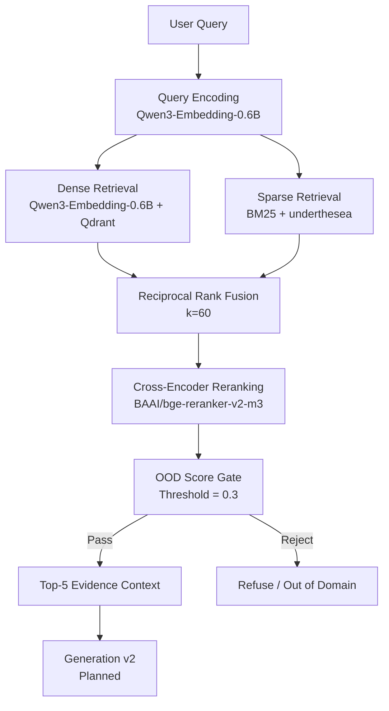

# Maternal Health RAG Assistant


> A local-first Vietnamese medical RAG system for maternal, reproductive-health, and newborn-care information, designed around evidence retrieval, traceable citations, conservative safety routing, and reproducible evaluation.

## Table of Contents

- [Problem & Motivation](#problem--motivation)
- [Key Results](#key-results)
- [System Architecture](#system-architecture)
- [Engineering Goals](#engineering-goals)
- [Experimental Development](#experimental-development)
  - [1. Chunking & Embedding Selection](#1-chunking--embedding-selection)
  - [2. Retrieval Pipeline Selection](#2-retrieval-pipeline-selection)
- [Final System Configuration](#final-system-configuration)
- [Getting Started](#getting-started)
- [Repository Structure](#repository-structure)
- [Knowledge Sources & Reproducibility](#knowledge-sources--reproducibility)
- [Limitations](#limitations)
- [Medical Disclaimer](#medical-disclaimer)

---

## Problem & Motivation

Vietnamese maternal-health guidance is often distributed across long clinical documents containing hierarchical sections, lists, tables, numeric thresholds, and conditional recommendations. A useful assistant therefore needs to do more than retrieve semantically similar text: it must preserve source structure, recover complete evidence, keep numbers and units grounded, expose traceable citations, and handle safety-sensitive questions conservatively.

This project explores the following engineering question:

> **How can a fully local Vietnamese medical RAG pipeline achieve high evidence coverage and ranking quality while keeping answers traceable, numerically grounded, and safe for patient-facing use?**

Instead of choosing a single RAG stack manually, the system is developed through controlled experiments across chunking, embeddings, retrieval, reranking, safety routing, and structured generation.

---

## Key Results

| Area | Result |
|---|---:|
| Held-out Evidence Recall@5 | **99.30%** |
| Held-out Evidence Recall@10 | **99.30%** |
| Held-out Evidence Recall@15 | **100.00%** |
| Held-out MRR | **88.65%** |
| Held-out nDCG@5 | **90.73%** |
| OOD Gate Accuracy (Dev) | **100.00%** |
| Generation v2 | *Planned* |

The system combines hierarchical chunking, Qwen3-0.6B embeddings, dense + sparse retrieval, Reciprocal Rank Fusion, BGE cross-encoder reranking, and deterministic score gating.

---

## System Architecture



---

## Engineering Goals

The project is intentionally designed as an evaluated RAG system rather than a simple `PDF → embedding → vector DB → LLM` demo.

| Goal | Design choice |
|---|---|
| Preserve clinical document structure | Hierarchical Markdown chunking |
| Retrieve both semantic and exact-term matches | Dense retrieval + BM25 |
| Improve candidate ordering | Cross-encoder reranking |
| Preserve Vietnamese lexical matching | `underthesea` word segmentation |
| Keep evidence traceable | Source metadata + breadcrumbs + `chunk_id` |
| Handle tables correctly | Table-preserving context construction |
| Avoid unsupported low-evidence answers | Deterministic score gate |
| Make local execution possible | Qdrant + Ollama + local models |
| Make design choices defensible | Controlled benchmarks and held-out evaluation |

---

## Experimental Development

The final architecture was selected through staged experiments instead of being chosen in advance.

### 1. Chunking & Embedding Selection

The indexing stage compares two chunking strategies and three embedding models under the same benchmark protocol.

#### Chunking strategies

| Strategy | Design goal |
|---|---|
| Semantic chunking | Group semantically related text segments |
| Hierarchical chunking | Preserve headings, sections, lists, and tables |

#### Embedding models

| Model | Role |
|---|---|
| `AITeamVN/Vietnamese_Embedding_v2` | Vietnamese-domain baseline |
| `Qwen/Qwen3-Embedding-0.6B` | Lightweight multilingual embedding model (1024 dims) |
| `BAAI/bge-m3` | Multilingual baseline |

#### Development indexing benchmark (Recall@10)

| Chunking | Embedding | Recall@10 |
|---|---|---:|
| Hierarchical | Vietnamese_Embedding_v2 | 91.13% |
| **Hierarchical** | **Qwen3-Embedding-0.6B** | **96.15%** |
| Hierarchical | bge-m3 | 92.14% |

#### Decision

**Hierarchical Chunking + Qwen3-Embedding-0.6B** was selected. It produced the strongest retrieval performance for Vietnamese queries within a strict local memory budget.

---

### 2. Retrieval Pipeline Selection

After freezing the indexing configuration, four retrieval pipelines were compared:

1. Dense-only
2. BM25-only
3. Dense + BM25 with RRF
4. Hybrid retrieval + cross-encoder reranking

#### Development comparison at K=5

| Pipeline | Evidence Recall@5 | Evidence Complete@5 | MRR | nDCG@5 |
|---|---:|---:|---:|---:|
| Dense-only | 96.15% | 94.23% | 81.03% | 84.65% |
| BM25-only | 90.38% | 90.38% | 80.25% | 82.52% |
| Hybrid | 96.15% | 94.23% | 81.65% | 84.77% |
| **Hybrid + Reranker** | **96.15%** | **94.23%** | **81.03%** | **84.65%** |

#### Decision

**Hybrid retrieval + BGE reranking** was selected. Although scores look similar at K=5, the reranker improves candidate stability and provides calibrated cross-encoder scores essential for Out-Of-Domain (OOD) rejection.

#### Held-out retrieval result (Test Set)

| Metric | Result |
|---|---:|
| Evidence Recall@5 | **99.30%** |
| Evidence Complete@5 | **99.30%** |
| MRR | **88.65%** |
| nDCG@5 | **90.73%** |

---

## Final System Configuration

The frozen Retrieval pipeline (`retrieval-v1-final`) operates in 5 steps:
1. **Query Encoding:** Qwen/Qwen3-Embedding-0.6B (run on CPU, `prompt_name='query'`, 1024 dims).
2. **Parallel Retrieval:** Qdrant Dense top-30 and BM25 Sparse top-30.
3. **Fusion:** Reciprocal Rank Fusion (k=60) pooling the top 30 unique candidates.
4. **Reranking:** BAAI/bge-reranker-v2-m3 (GPU, FP16, batch_size=16, max_length=1024) keeping top-5.
5. **OOD Safety Gate:** If the top-1 reranker score is `< 0.3`, the query is rejected as Out-Of-Domain. Otherwise, 5 chunks (prepended with breadcrumbs) are passed to Generation.

> **Note on Tokenizer:** The text chunks (budget=512 tokens) were segmented using the `Qwen/Qwen3-Embedding-0.6B` tokenizer (which is finer-grained for Vietnamese), rather than `bge-m3`. Therefore, this 512 budget is not directly comparable to early chunking evaluations that used `bge-m3`. This is beneficial as it prevents hitting the 1024 max_length of the reranker.

---

## Getting Started

### Prerequisites

- Python 3.10+
- Qdrant running locally
- NVIDIA GPU recommended for reranking

### 1. Clone the repository

```bash
git clone <repository-url>
cd rag-phu-san-chatbot
```

### 2. Create a Python environment

#### Windows PowerShell

```powershell
python -m venv .venv
.\.venv\Scripts\Activate.ps1
python -m pip install --upgrade pip
pip install -r requirements.txt
```

#### macOS / Linux

```bash
python3 -m venv .venv
source .venv/bin/activate
python -m pip install --upgrade pip
pip install -r requirements.txt
```

### 3. Start Qdrant

#### macOS / Linux

```bash
docker run --rm --name qdrant \
  -p 6333:6333 -p 6334:6334 \
  -v "$(pwd)/data/vector_db/qdrant:/qdrant/storage" \
  qdrant/qdrant
```

#### Windows PowerShell

```powershell
docker run --rm --name qdrant `
  -p 6333:6333 -p 6334:6334 `
  -v "${PWD}/data/vector_db/qdrant:/qdrant/storage" `
  qdrant/qdrant
```

### 4. Build the knowledge index

The generated vector and sparse-index artifacts are not shipped with the repository. Build them from the cleaned source documents:

```bash
python evaluation/scripts/indexing/build_vector_store.py --qdrant-mode server --host localhost --port 6333 --recreate
```

The indexing script uses the frozen configuration:

```text
Hierarchical chunking (max 512 tokens)
Qwen/Qwen3-Embedding-0.6B
Qdrant collection: phu_san_chunks
BM25 sparse index
```

---

## Repository Structure

```text
src/
├── indexing/
│   ├── document loading and cleaning
│   ├── chunking
│   ├── embedding
│   └── vector storage
│
├── retrieval/
│   ├── dense retrieval
│   ├── sparse retrieval
│   ├── hybrid fusion
│   ├── reranking
│   └── config.py
│
└── pipeline.py
    └── pure retrieval and reranking pipeline

evaluation/
├── datasets/
│   └── benchmark questions, manifests, reviewed labels
├── schemas/
│   └── evaluation schemas
├── scripts/
│   └── indexing, retrieval, and pipeline testing
└── results/
    └── organized benchmark outputs
```

---

## Knowledge Sources & Reproducibility

The knowledge base is built from seven Vietnamese Ministry of Health guidance documents covering:

- prenatal care;
- reproductive health services;
- nutrition during pregnancy and lactation;
- hypertension and preeclampsia;
- gestational diabetes;
- family planning and safe abortion;
- newborn care.

To preserve experimental traceability, the repository keeps the following concepts separate:

```text
Source medical documents
        ↓
Cleaned knowledge documents
        ↓
Generated chunks / indexes
        ↓
Reviewed benchmark labels
        ↓
Model outputs
        ↓
Evaluation results
```

Benchmark datasets, manifests, evaluation scripts, and reported metrics are organized separately from generated outputs so that system development decisions can be reproduced and audited.

---

## Limitations

- Citation validation confirms reference structure and traceability, not clinical correctness.
- Numeric/unit checks are conservative safeguards and do not replace expert medical review.
- Benchmark results are specific to the current document collection, reviewed evaluation set, and system configuration.
- **Known Retrieval Edge Cases:**
  - `1139_009`: Bullets in chunks that merge multiple topics might retrieve loosely related but incorrect context.
  - `776_002`: The reranker tends to incorrectly down-rank data-heavy table chunks.
  - `1359_016`: The reranker occasionally assigns high confidence to incorrect matches, which bypasses the score gate.
- The system provides evidence-based medical information only.
- It does **not** diagnose, prescribe, adjust treatment, or replace a qualified healthcare professional.

---

## Medical Disclaimer

This project is an information-retrieval and educational system based on selected Vietnamese medical guidance documents.

It is **not a doctor**, is **not a validated clinical decision-support system**, and must not be used as a substitute for professional medical evaluation, diagnosis, treatment, or emergency care.

If urgent or dangerous symptoms are present, contact emergency services or go to the nearest healthcare facility immediately.
